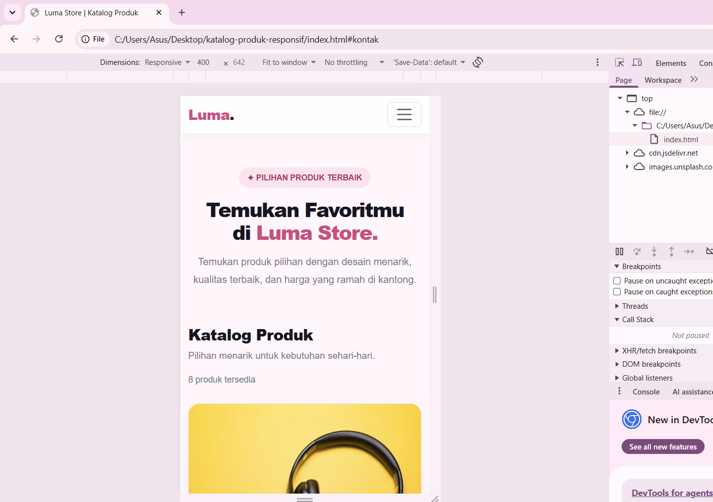
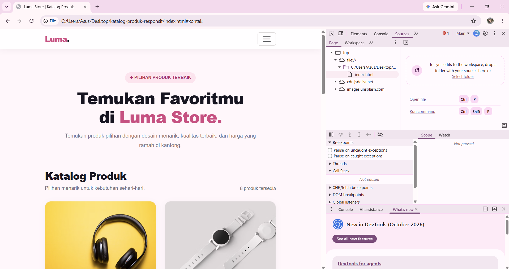

# Katalog Produk Responsif — Luma Store

## Identitas
- Nama: Fadhluna Andini
- NIM: 4253250035
- Mata Kuliah: Pemrograman Web
- Tugas: Tugas Rutin 3 — Katalog Produk Responsif

## Deskripsi
Luma Store merupakan website katalog produk sederhana
yang menampilkan delapan produk dengan gambar, nama,
deskripsi, harga, dan tombol beli simulasi.

Website dibuat menggunakan HTML, CSS, Bootstrap 5,
dan JavaScript dengan pendekatan mobile-first.

## Teknologi
- HTML5
- CSS3
- Bootstrap 5.3.3
- JavaScript

## Fitur
1. Navbar responsif dengan menu hamburger pada perangkat kecil.
2. Delapan kartu produk.
3. Gambar produk responsif.
4. Nama, deskripsi, dan harga pada setiap kartu.
5. Tombol beli dengan pesan simulasi.
6. Grid satu kolom pada mobile.
7. Grid dua kolom pada tablet.
8. Grid empat kolom pada desktop.
9. Footer.
10. Penyesuaian ukuran tipografi.

## Cara Menjalankan
1. Unduh atau clone repositori.
2. Buka folder proyek.
3. Buka file index.html menggunakan browser.
4. Pastikan koneksi internet tersedia untuk memuat Bootstrap
   dan gambar produk dari sumber eksternal.

## Dokumentasi Pengujian

### 1. Mobile — 375 × 812 px

Hasil yang diharapkan:
Satu kolom produk dan menu hamburger.

### 2. Tablet — 800 × 1024 px

Hasil yang diharapkan:
Dua kolom produk dengan gambar yang proporsional.

### 3. Desktop — 1366 × 768 px

Hasil yang diharapkan:
Empat kolom produk dan navbar horizontal.

## Kesimpulan
Website katalog produk dibuat dengan pendekatan mobile-first
dan diuji pada tiga ukuran layar. Tata letak, gambar produk,
navigasi, dan elemen halaman dirancang agar menyesuaikan
ukuran perangkat.
